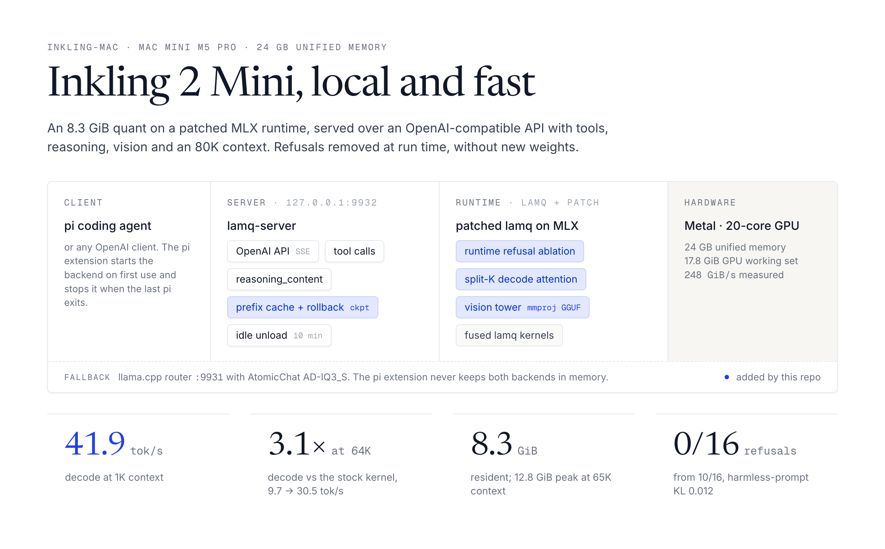
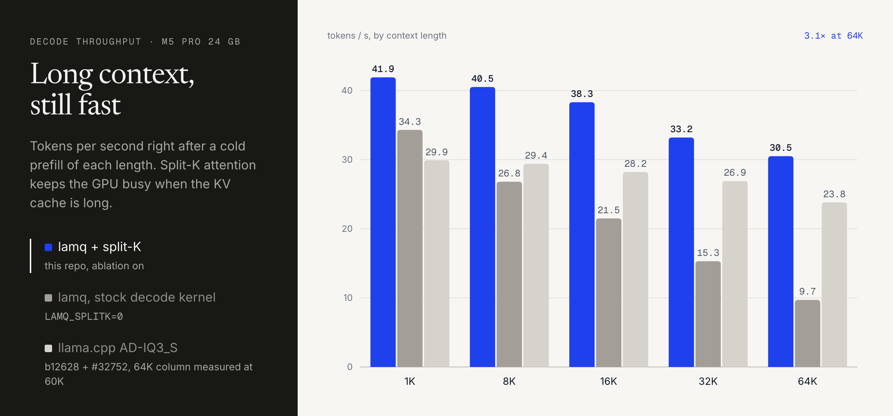
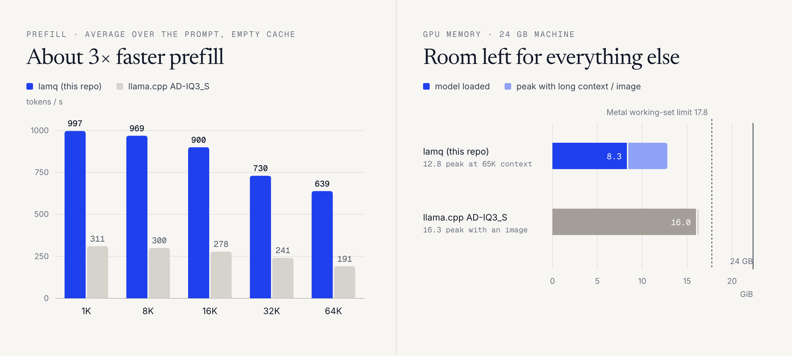
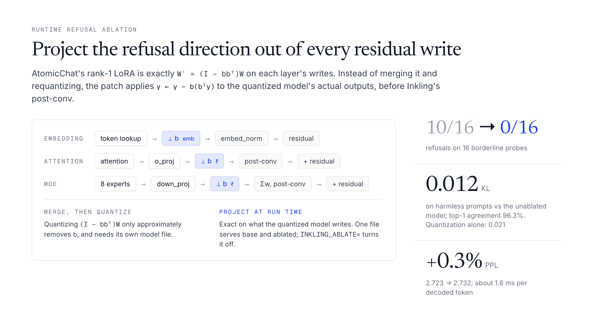
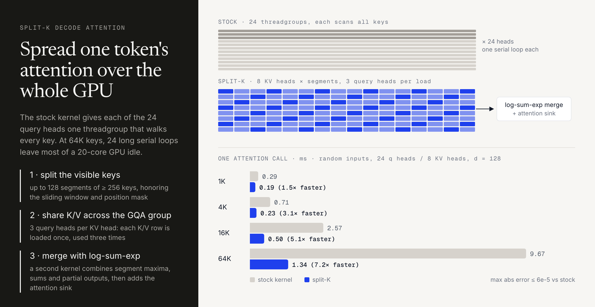

# inkling-mac

Running **Inkling 2 Mini** as a local coding-agent model on a **24 GB Apple Silicon Mac** (measured on a Mac mini M5 Pro:
18-core CPU, 20-core GPU, 24 GB). Everything needed to go from a clean machine to an OpenAI-compatible endpoint with
tools, reasoning, vision and an 80K context, plus the measurements behind each choice.



| Piece | What it does |
|---|---|
| `lamq/lamq.patch` | Patch for the [LookAtMyQuant](https://github.com/ShinMegamiBoson/lookatmyquant) (lamq) MLX runtime: **runtime refusal ablation** and a **split-K decode-attention kernel** |
| `lamq/server.py` | OpenAI-compatible server (streaming, tool calls, `reasoning_content`, images, prefix cache with rollback checkpoints, idle unload) |
| `lamq/inkling_vision.py` | Inkling 2 vision tower in MLX, reading llama.cpp's mmproj GGUF directly |
| `lamq/ablate-dirs.npz` | 24 per-layer + 1 embedding refusal directions extracted from AtomicChat's rank-1 LoRA (`extract-dirs.py`) |
| `llama.cpp/` | Fallback backend: pinned llama.cpp build + router preset for AtomicChat's AD-IQ3_S GGUF |
| `pi/` | Extension + provider config for the [pi](https://pi.dev) coding agent: starts the right backend on first use, stops it when the last pi exits |
| `bench/`, `tests/` | Speed / perplexity / ablation benchmarks, kernel unit test, teacher-forced KL check, server end-to-end test |

## Results (Mac mini M5 Pro, 24 GB)

lamq 8.9GB + runtime ablation + split-K, vs AtomicChat AD-IQ3_S on llama.cpp (b12628 + #32752, ubatch 128, KV q8_0).
Single request; lamq greedy, llama.cpp temp 1.0.





Prefill is the average over the whole prompt from an empty cache; decode is measured right after it, at that depth.

| context | lamq prefill tok/s | lamq decode tok/s | decode with the stock lamq kernel | llama.cpp prefill tok/s | llama.cpp decode tok/s |
|---|---|---|---|---|---|
| 1K | 997 | **41.9** | 34.3 | 311 | 29.9 |
| 8K | 969 | **40.5** | 26.8 | 300 | 29.4 |
| 16K | 900 | **38.3** | 21.5 | 278 | 28.2 |
| 32K | 730 | **33.2** | 15.3 | 241 | 26.9 |
| 64K | 639 | **30.5** | 9.7 | 191 (60K) | 23.8 (60K) |

lamq numbers from `bench/bench.py speed --ablate lamq/ablate-dirs.npz` (ablation on; `LAMQ_SPLITK=0` for the stock
column), llama.cpp numbers from its server timings with the preset in `llama.cpp/models.ini.in`.

| | lamq 8.9GB (this repo) | llama.cpp AD-IQ3_S |
|---|---|---|
| Weights on disk | 8.3 GiB + 0.6 GiB mmproj | 13.3 GB + 0.6 GiB mmproj |
| GPU memory, model loaded | 8.3 GiB | 16.0 GiB (80K KV and compute buffers preallocated) |
| GPU memory, peak | 12.8 GiB at 65K context | 16.3 GiB with a 2000×2000 image |
| Perplexity (8 × 4096 tokens of English technical docs, second half scored) | 2.732 (2.723 without ablation) | 2.674 (unablated Unsloth UD-Q3_K_XL: 2.650) |

The lamq file is a lot smaller for a 2% perplexity cost; on a 24 GB machine that headroom is what lets an 80K
context, an image, a browser and an editor coexist without swapping.

**Refusal ablation** (`bench/bench.py abl`, 16 borderline probes, 8 harmless prompts, reasoning effort "none"):
refusals 10/16 → 0/16; on harmless prompts teacher-forced KL 0.0117 vs the unablated model, top-1 agreement 96.3%.
For scale, the quantization itself costs KL 0.021 against BF16. The probe set is small and the refusal classifier
is a keyword match, so treat these as a sanity check rather than a safety evaluation.

**Split-K decode attention** (`tests/test_splitk.py`, one attention call, 24 query heads / 8 KV heads, d = 128):

| keys in context | stock kernel | split-K | max abs error |
|---|---|---|---|
| 1K (sliding layer) | 0.29 ms | 0.19 ms | 3e-6 |
| 4K | 0.71 ms | 0.23 ms | 1e-5 |
| 16K | 2.57 ms | 0.50 ms | 3e-5 |
| 64K | 9.67 ms | 1.34 ms | 6e-5 |

End to end, split-K's numerical effect is smaller than the stock runtime's own prefill-vs-decode difference:
teacher-forced KL against the stock kernel is 9.6e-4 at 20K context, while stock decode vs stock prefill on the same
tokens differs by 6.1e-3 (`tests/tf_splitk.py`).

## How it works

### Why lamq instead of llama.cpp

Inkling 2 Mini is a looped MoE: 24 physical layers, some executed several times per token ("visits"), most attention
layers use a 1024-token sliding window and only 8 visits keep a full KV cache. LookAtMyQuant packs it with per-row bit
allocation and ships its own MLX runtime with fused Metal kernels. At 8.3 GiB vs 13.3 GB, and with
prefill ~3× faster than llama.cpp's Inkling path, it is the better fit for a 24 GB machine. The runtime is used as
is, at a pinned commit, plus `lamq.patch`.

### Runtime refusal ablation



AtomicChat's uncensored GGUF comes with a rank-1 LoRA. Inspecting it (`extract-dirs.py`) shows that in every layer the
attention output projection and all 128 experts' down projections share one unit vector `b`, with `lora_a = -Wᵀb`. That
makes the edit exactly a directional ablation `W' = (I - bbᵀ) W`: whatever a layer writes into the residual stream has
its component along `b` removed. The embedding gets the same treatment with its own direction.

AtomicChat merges this into BF16 weights and then quantize. That works, but the quantized `W'` no longer projects `b` out
exactly, and it needs its own quantized file. Here the projection is applied at run time instead,
`y ← y − b (bᵀy)`, to the *actual quantized outputs* of `o_proj`, each expert's `down_proj`, and the embedding lookup.
The direction is then removed exactly from what the quantized model writes, the same file serves both the base and
the ablated model, and the directions can be swapped without requantizing.

Placement matters because Inkling applies a short causal convolution after attention and after the MoE block before
adding to the residual. The patch ablates *before* that post-conv, which is where the LoRA acted in the original
weights (on `o_proj` / `down_proj`). Cost: about 1.6 ms per decode step (~6%), none measurable in prefill.

### Split-K decode attention



The stock lamq decode kernel gives each query head one threadgroup that walks the whole KV cache. With 24 heads that is
24 threadgroups on a 20-core GPU: fine at 1K keys, but at 64K every threadgroup runs a long serial loop and the GPU is
mostly idle, so attention grows to ~10 ms per call.

The split-K kernel (in `lamq.patch`, `fast_kernels.py`):

1. splits the visible key range (respecting the sliding window and the absolute-position mask) into up to 128 segments
   of ≥256 keys, one threadgroup per (KV head, segment);
2. computes the 3 query heads that share a KV head together, so each K/V row is loaded once and used three times;
3. writes per-segment running max, sum and partial output, and a second small kernel merges the segments with
   log-sum-exp and adds Inkling's attention-sink logit.

Prefill (T ≥ 32 query tokens) still uses the stock flash kernel. `LAMQ_SPLITK=0` restores the stock decode kernel.

### Vision

`inkling_vision.py` ports the Inkling 2 vision tower from mlx-vlm and loads its weights straight from llama.cpp's
`mmproj` GGUF, so no second copy of the projector is needed. Preprocessing follows llama.cpp's
`mtmd_image_preprocessor_inkling2v` (native resolution, padding to a multiple of 40, downscaling only above 4096 image
tokens). Per-token cosine similarity against the mlx-vlm reference: ≥ 0.99998. Image features bypass `embed_norm`
and the ablation and replace the image placeholder tokens.

### Prefix cache with rollback

Agents resend the whole conversation every turn, so the server keeps one live cache and reuses its longest matching
prefix. Rolling back is the hard part here: the post-convs carry a 3-token state that cannot be trimmed, and sliding-
window layers drop old keys. The server therefore takes **checkpoints**: the conv state (by reference; the runtime
rebinds rather than mutates it) plus a copy of the last 1024 keys/values of every sliding layer, ~160 MB each.
Global-attention KV is append-only, so restoring it only resets a length. Checkpoints sit at the end of the system
prompt and tool declarations and at the second-to-last prompt token, so both "new user turn" and "regenerate"
roll back cheaply. Restored state is bit-identical to a fresh prefill. Images hash into the token key, so a different
image never matches.

### Where decode time goes

At 1K context one decode step takes ~23 ms. Streaming the 1.94 GiB of weights a token touches takes ~7.8 ms at the
measured 248 GiB/s, and building the graph in Python takes ~3.1 ms. Most of the rest is launch overhead:
~1000–1500 small kernels per token at ~3.3 µs each. Further speedups will come from fusing kernels or verifying
several tokens per weight pass (speculative decoding), not from more bandwidth.

## Install

Requirements: Apple Silicon macOS, [uv](https://docs.astral.sh/uv/), git, ~10 GB of disk (plus 13 GB for the optional
llama.cpp model).

```bash
git clone https://github.com/fish2lab/inkling-mac && cd inkling-mac
```

```bash
./lamq/install.sh              # patched lamq runtime -> ~/.local/share/inkling-mac/venv (about 30 s)
```

```bash
./scripts/download-models.sh   # lamq 8.9GB + vision projector into the Hugging Face cache, pinned revisions
```

Optional fallback backend:

```bash
./scripts/download-models.sh --llama && ./llama.cpp/install-llama.sh
```

## Use

```bash
./lamq/lamq-server             # http://127.0.0.1:9932/v1, model id inkling-2-mini-lamq; loads on the first request
```

```bash
curl -s http://127.0.0.1:9932/v1/chat/completions -H 'Content-Type: application/json' -d '{
  "model": "inkling-2-mini-lamq",
  "messages": [{"role": "user", "content": "Write a shell one-liner that counts lines of Python in a repo."}],
  "chat_template_kwargs": {"reasoning_effort": "low"}}'
```

Reasoning arrives in `reasoning_content`; send it back on assistant turns so the prefix cache keeps hitting.
`reasoning_effort` takes `none`, `minimal`, `low`, `medium`, `high`, `xhigh`. Sampling defaults to temp 1.0,
top-p 1.0 (the model's recommendation). `"cache_prompt": false` forces a cold prefill.

### With pi

```bash
mkdir -p ~/.pi/agent/extensions && ln -s "$PWD/pi/local-llm.ts" ~/.pi/agent/extensions/inkling-mac.ts
```

Then merge the providers from `pi/models.json` into `~/.pi/agent/models.json` (or symlink it if you have none) and
pick `lamq/inkling-2-mini-lamq`. The extension starts the backend on the first request, switches between the lamq
and llama.cpp backends (never both in memory), and stops them when the last pi process exits; backends idle-unload
after 10 minutes. Logs: `~/Library/Logs/inkling-mac-{lamq,llama}.log`.

### Environment

| Variable | Default | Used by |
|---|---|---|
| `INKLING_MAC_HOME` | `~/.local/share/inkling-mac` | install scripts, launchers |
| `INKLING_LAMQ_MODEL` | pinned snapshot in the HF cache | `lamq-server` |
| `INKLING_MMPROJ` | pinned snapshot in the HF cache | `lamq-server` |
| `INKLING_ABLATE` | `lamq/ablate-dirs.npz`; empty string serves the unmodified model | `lamq-server` |
| `INKLING_LAMQ_PORT` | `9932` | `lamq-server` |
| `LAMQ_SPLITK` | `1` | runtime: `0` uses the stock decode kernel |
| `INKLING_MAC_REPO` | this checkout | pi extension |
| `LLAMA_SERVER_BIN` | `$INKLING_MAC_HOME/llama.cpp/current/llama-server` | `llama.cpp/router` |

## Tests and benchmarks

Run with the installed venv (`~/.local/share/inkling-mac/venv/bin/python`):

```bash
python tests/test_splitk.py                                   # kernel vs stock, random inputs, no model needed
python tests/test_server.py                                   # against a running lamq-server
python tests/tf_splitk.py --corpus docs.txt --ctx 20000       # teacher-forced KL, split-K vs stock vs prefill
python bench/bench.py speed --corpus docs.txt --ablate lamq/ablate-dirs.npz
python bench/bench.py abl   --corpus docs.txt --ablate lamq/ablate-dirs.npz
```

`--corpus` is any long text file; the numbers above used pi's documentation concatenated (not included).

The figures are HTML pages in `docs/figures/src/`; `docs/figures/render.sh` turns them into the PNGs with a headless
Chromium (`CHROME=...`) and Pillow (`PY=...`).

## Responsible use

The ablation removes the model's learned refusals. That is useful for security research, red-teaming, fiction, and
for not being refused on ordinary sysadmin or medical questions, but the model will also comply with requests it
should not. You are responsible for what you do with it. Set `INKLING_ABLATE=` to run the unmodified model.

## Credits

lamq runtime and packed model by Shin Megami Boson; vision tower ported from mlx-vlm (Prince Canuma); refusal
directions from AtomicChat's Inkling-2-Mini-Uncensored LoRA; llama.cpp by ggml-org. Licenses in `NOTICE.md`.
This repository: MIT.
